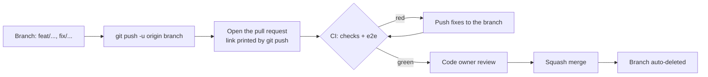

# Maintainer guide

How the GitHub repository is configured, and how changes reach `main`. Most of it is one-time setup in the
repository settings; the files it relies on are in `.github/`.

## How a change reaches main

Contributors never push to `main`: they work on a branch, push it, and open a pull request. The repository uses
the `git` CLI only.

## Deploy to the Pulse VPS

`main` on GitHub is the source of code. After the `CI` workflow finishes successfully for `main`,
[.github/workflows/deploy-vps.yml](../.github/workflows/deploy-vps.yml) can connect to the VPS over SSH and call
[scripts/deploy-vps.sh](../scripts/deploy-vps.sh), which in turn runs the guarded
[scripts/deploy.sh](../scripts/deploy.sh) in `/home/altlabs/services/pulse`.

The deploy script fetches the selected branch, creates a PostgreSQL dump, builds the image, waits for the container
healthcheck and rolls back to the previous image when the new container does not become healthy. It refuses tracked
changes and untracked files in the checkout. This is deliberate: manual work on the VPS must be reviewed and saved in
a branch before a deploy can touch that checkout.

Create a GitHub Actions environment named `production` and add these secrets to it:

| Secret | Purpose |
|---|---|
| `PULSE_VPS_HOST` | VPS hostname or IP |
| `PULSE_VPS_PORT` | SSH port; defaults to `41122` |
| `PULSE_VPS_USER` | SSH user; defaults to `altlabs` |
| `PULSE_VPS_PATH` | Checkout path; defaults to `/home/altlabs/services/pulse` |
| `PULSE_VPS_SSH_PRIVATE_KEY` | Private key allowed to log in as the deploy user |
| `PULSE_VPS_KNOWN_HOSTS` | The pinned `known_hosts` line for that host and port |

The deploy workflow does not read the application `.env`, does not push to GitHub and never uses a force push. Keep
the application secrets on the VPS and the SSH material in the GitHub Actions environment only. Configure an approval
rule on `production` if deployment should require a manual gate.

For a one-time host-key capture, verify the fingerprint out of band before saving the result:

~~~sh
ssh-keyscan -p 41122 76.13.234.196
~~~

## Sync a local checkout

Use [scripts/sync-local.sh](../scripts/sync-local.sh) from a clean checkout. It fetches the requested branch from
`origin`, switches branches without discarding anything and updates with `git merge --ff-only`:

~~~sh
scripts/sync-local.sh main
scripts/sync-local.sh feat/pt-br
~~~

If it reports local changes, stop and review them first. Do not make the VPS a second source of truth: commit reviewed
work to a branch, push that branch to the fork, and let the pull request and CI be the path to `main`.

The maintainer (repository admin) is on the ruleset's bypass list with **Always**, so they can push to `main`
directly as well as merge their own pull requests without a second reviewer. Everyone else goes through a PR
with green CI and a code owner review.

## One-time repository settings

### Ruleset for main

**Settings › Rules › Rulesets › New ruleset › Import a ruleset**, and pick
[`.github/rulesets/main.json`](../.github/rulesets/main.json). It applies to the default branch and:

| Rule | Effect |
|---|---|
| Restrict deletions | `main` can't be deleted |
| Block force pushes | History on `main` can't be rewritten |
| Require linear history | Only squash merges, no merge commits |
| Require a pull request | 1 approval, from a code owner (`.github/CODEOWNERS`); stale approvals are dismissed on new pushes; the last pusher can't approve; all review threads resolved |
| Require status checks | `checks` and `e2e` from `.github/workflows/ci.yml`, on a branch up to date with `main` |
| Bypass | Repository admins, always (direct pushes and their own PRs) |

The required checks only exist after CI has run once, so merge the pull request that adds the workflow first,
or let one CI run finish before importing.

### General

- **Pull requests:** allow squash merging only; turn on **Automatically delete head branches**; turn on
  **Always suggest updating pull request branches**.
- **Features:** turn off Wiki and Projects unless you use them; Issues on; Discussions optional.

### Security (Settings › Code security)

- **Private vulnerability reporting:** on (SECURITY.md points reporters there).
- **Dependency graph, Dependabot alerts and Dependabot security updates:** on. Version updates come from
  `.github/dependabot.yml`.
- **Secret scanning** and **Push protection:** on, so a pushed token is blocked.
- **Code scanning (CodeQL) default setup:** on.

### Actions (Settings › Actions › General)

- **Workflow permissions:** read repository contents only; leave "Allow GitHub Actions to create and approve
  pull requests" off.
- **Fork pull request workflows:** require approval for first-time contributors (or all outside
  collaborators), so a stranger's PR can't run code in CI before you've read it.

## Contributions from others

- Contributors fork, branch and open a PR; CI runs once you approve the workflow for a first-time contributor.
- Commits need a DCO sign-off (`Signed-off-by:`); ask for `git commit --amend -s` if it's missing.
- Squash merge with a Conventional Commit title.
